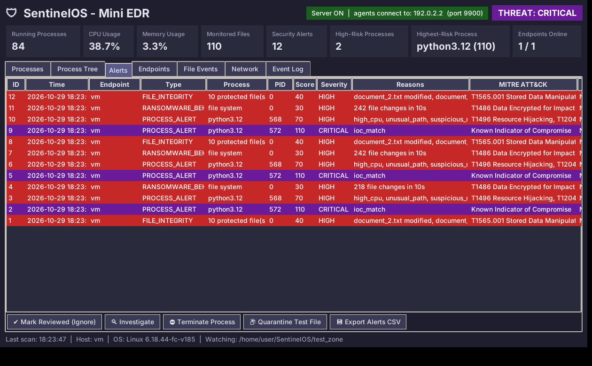

# SentinelOS – Mini Endpoint Detection & Response System

An Operating Systems + Cybersecurity project. SentinelOS monitors an endpoint's
**processes, files and network connections**, scores suspicious behaviour with
rules, raises alerts, logs everything to SQLite and offers safe, user-confirmed
responses through a Tkinter dashboard.



## Features

- **Process monitoring** – PID, parent, CPU, memory, threads, path, start/stop timeline
- **Process tree** – parent → child view; flags Office apps that start a shell
- **File monitoring** – create/modify/delete/rename events + SHA-256 integrity checks
- **Ransomware-behaviour detection** – bursts of file changes
- **Network monitoring** – connections mapped to processes, suspicious ports
- **IoC blocklist** (`iocs.json`) – known-bad hashes, process names and IPs
- **Rule-based risk scoring** with **MITRE ATT&CK** mapping
- **Alerts + safe responses** – investigate, terminate (confirmed), quarantine, mark reviewed
- **Trusted list** – whitelist false positives from the dashboard
- **SQLite logging** + CSV export
- **Multi-endpoint mode** – agents on other laptops report to one dashboard

## Setup

Requires Python 3.9+ (Tkinter is included with the Windows/macOS installer).

```
pip install -r requirements.txt
```

## Run

```
python main.py                    # dashboard
python main.py --server           # dashboard + accept reports from agents
python main.py --agent SERVER_IP  # monitor this laptop and report to the server
python main.py --cli              # console mode
python -m unittest                # run the detection tests
```

Run the terminal **as Administrator** to see the paths and connections of
protected system processes. Without it the EDR still works and skips them.

## Safe demo (project section 18)

Open a second terminal while the dashboard is running:

```
python demo/setup_test_zone.py     # 1. run BEFORE starting the EDR (creates protected sample files)
python main.py                     # 2. start the dashboard
python demo/suspicious_test.py     # 3. harmless "suspicious" program
```

The demo copies itself to the TEMP folder, uses CPU, edits text files inside
`test_zone/` only and opens a **local** (127.0.0.1) connection on port 4444.
Expected result: the demo process reaches **HIGH (score 100)** and you get
`PROCESS_ALERT`, `RANSOMWARE_BEHAVIOR` and `FILE_INTEGRITY` alerts. Select the
alert and click **Terminate Process** to respond.

Smaller tests: `demo/cpu_test.py` (high CPU alone stays LOW – no false
positive), `demo/file_burst_test.py` (file-burst alert only) and
`demo/ioc_test.py` (connects to the demo IoC address 127.0.0.66 on loopback →
CRITICAL).

## Monitoring a second laptop (with the owner's permission)

Only monitor computers whose owner has agreed to it.

1. Both laptops on the **same Wi-Fi**, project copied to both, and the same
   `AGENT_TOKEN` in `sentinelos/config.py` on both (change the default!).
2. On **your** laptop: `python main.py --server`. The green label in the
   header shows the IP agents must use. If Windows Firewall asks, allow
   Python on **Private networks**.
3. On the **other** laptop: `python main.py --agent <IP from step 2>`
4. The laptop appears in the **Endpoints** tab and its alerts in the Alerts
   tab (Endpoint column). Remote terminate is disabled on purpose – responses
   happen on the endpoint itself.


## Project structure

| File | Module |
|---|---|
| `sentinelos/system_info.py` | 1. System information |
| `sentinelos/process_monitor.py` | 2. Process monitor (PID, PPID, CPU, memory, threads, path) |
| `sentinelos/file_monitor.py` | 3. File monitor (watchdog) + SHA-256 integrity |
| `sentinelos/network_monitor.py` | 4. Network monitor (connections → process) |
| `sentinelos/detection.py` | 5–6. Detection rules + risk scoring |
| `sentinelos/engine.py` | 7. Alert manager + scan workflow |
| `sentinelos/response.py` | 8. Investigate / terminate / quarantine |
| `sentinelos/database.py` | 9. SQLite + log file (`data/`) |
| `sentinelos/dashboard.py` | 10. Tkinter dashboard |
| `sentinelos/lists.py` | IoC blocklist + trusted list |
| `sentinelos/remote.py` | Agent → server (multi-endpoint) |
| `sentinelos/config.py` | Thresholds, scores, MITRE mapping, trusted folders |
| `iocs.json` | Indicators of Compromise |
| `tests/` | Unit tests for the detection rules |

## Risk scoring

| Indicator | Points |
|---|---|
| Unknown process (outside trusted folders) | +20 |
| CPU ≥ 80% | +10 |
| Running from Temp / Downloads | +25 |
| Caused a burst of file changes (≥ 50 in 10 s) | +30 |
| Connection to a suspicious port (4444, 1337, …) | +20 |
| Office/PDF app started a shell (e.g. Word → PowerShell) | +65 |
| Matches an IoC (hash, name or IP in `iocs.json`) | +110 |
| 3 or more indicators together | +15 |

Each indicator is mapped to a MITRE ATT&CK technique (e.g. file burst →
T1486 Data Encrypted for Impact) shown in the Alerts tab.

0–30 LOW · 31–60 MEDIUM · 61–100 HIGH · above 100 CRITICAL. Alerts are raised
from HIGH. All values are project-defined and can be tuned in `config.py`.

## Safety

Defensive monitoring only. Responses always ask for confirmation, quarantine
only works inside `test_zone/`, and the demo programs are harmless.
