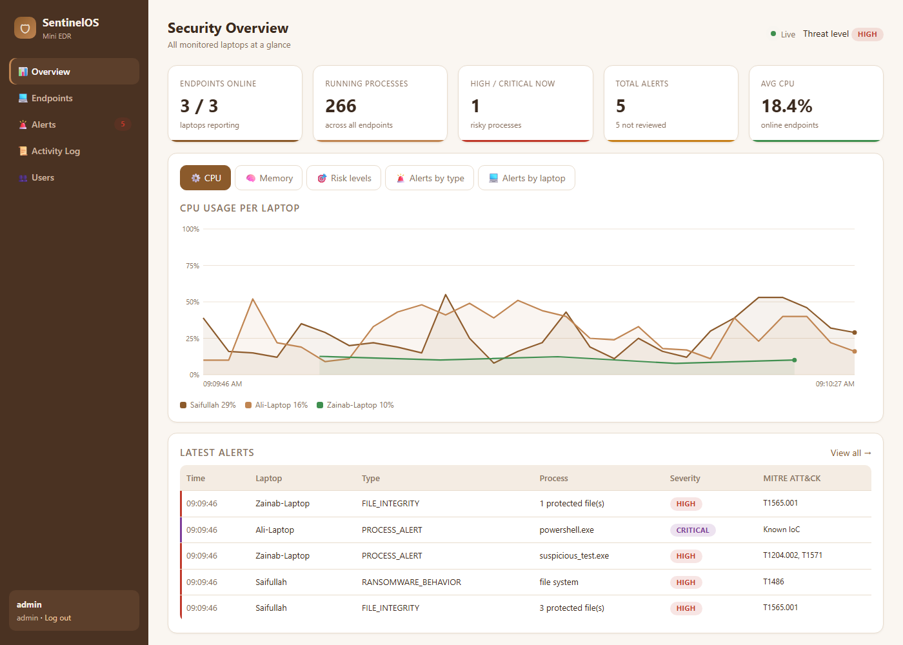
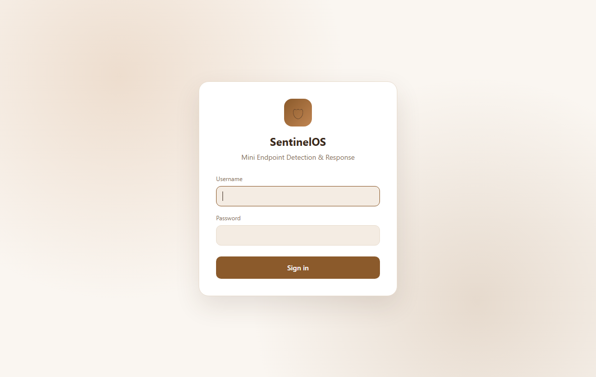
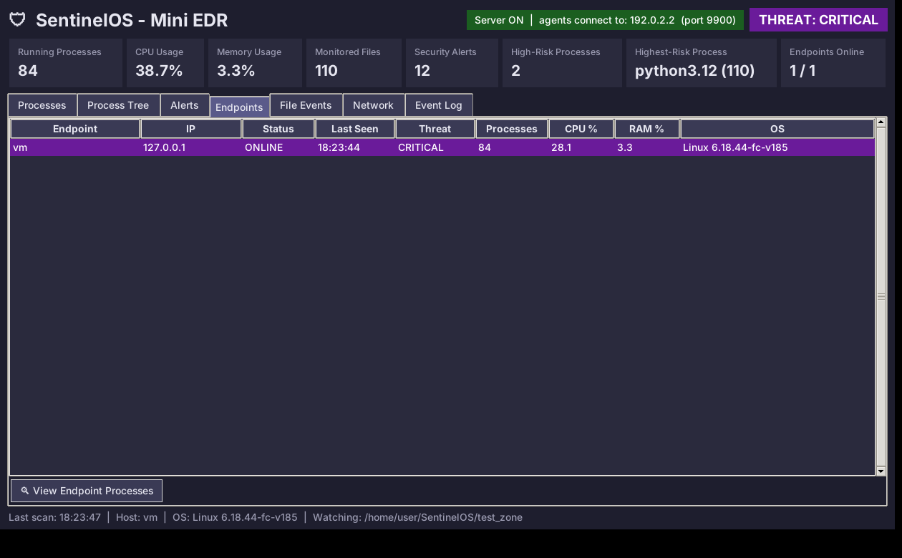
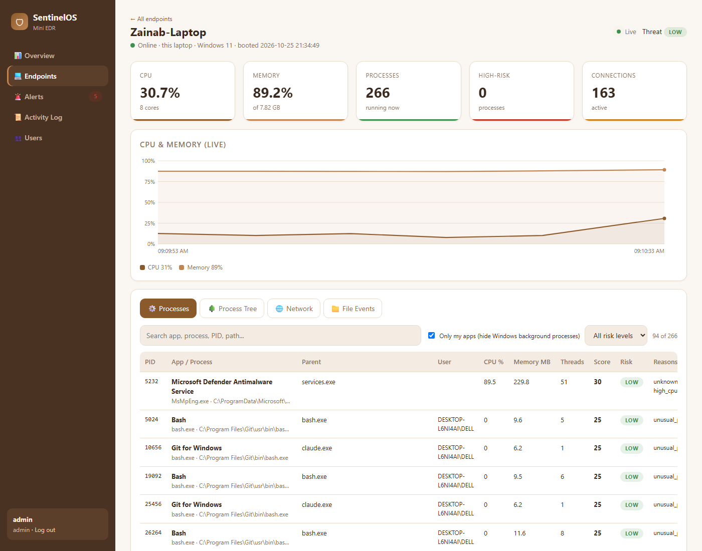
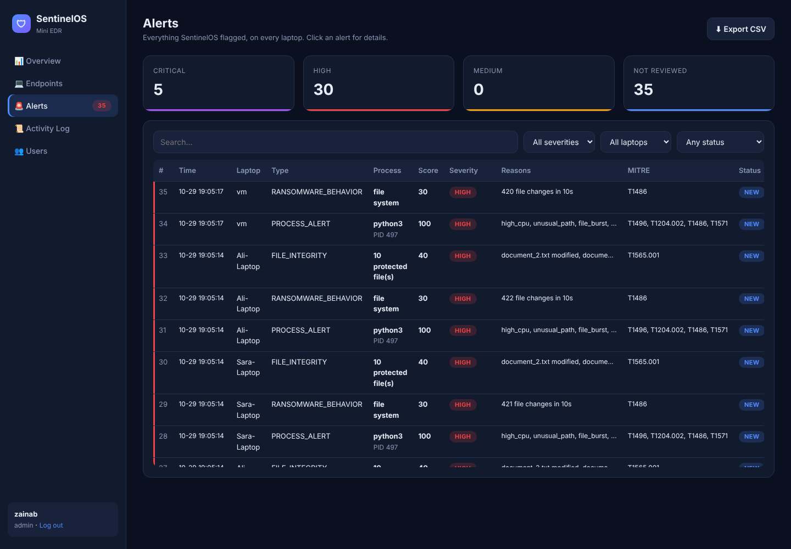
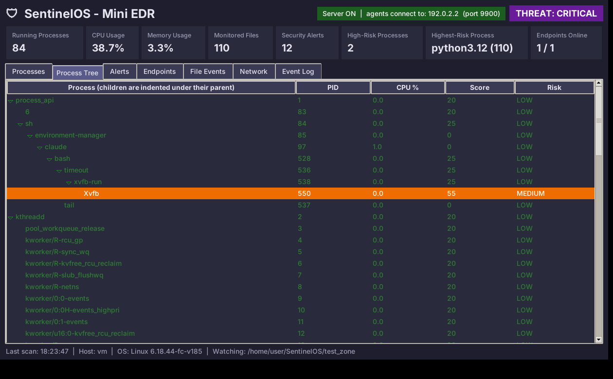

# SentinelOS – Mini Endpoint Detection & Response System

An Operating Systems + Cybersecurity project. SentinelOS monitors the
**processes, files and network connections** of one or more laptops, scores
suspicious behaviour with rules, raises alerts, logs everything to SQLite and
shows it all on a **web dashboard with login, live graphs and four dashboard
pages**.



## Features

- **Login** with hashed passwords, roles (**admin** / **viewer**), lockout after 5 wrong tries
- **4 dashboards:** Overview (graphs), Endpoints, Alerts, Activity Log (+ Users page for admins)
- **Live graphs:** CPU and memory per laptop, risk levels, alerts by type and by laptop
- **Multi-endpoint:** agents on group members' laptops report to one dashboard
- **Process monitoring:** every running process with PID, parent, user, CPU, memory, threads, path
- **Process tree:** parent → child view; flags Office apps that start a shell
- **File monitoring:** create/modify/delete/rename events + SHA-256 integrity checks
- **Ransomware-behaviour detection:** bursts of file changes
- **Network monitoring:** connections mapped to processes, suspicious ports
- **IoC blocklist** (`iocs.json`): known-bad hashes, process names and IPs
- **Rule-based risk scoring** with **MITRE ATT&CK** mapping
- **Safe responses:** terminate (admin only, confirmed), mark alerts reviewed/resolved/false positive
- **SQLite logging** + CSV export
- **17 unit tests** (detection rules + login/API security)

## Setup

Requires Python 3.9+.

```
pip install -r requirements.txt
python demo/setup_test_zone.py
```

## Run the dashboard

```
python main.py
```

On the **first run** the terminal asks you to create the **admin** account
(the password is hidden while you type). Then open **http://localhost:8000** and
sign in.



**Teacher account:** log in as admin → **Users** → add e.g. `teacher` with role
**viewer**. A viewer can see every page but cannot terminate processes or
change anything. The teacher can open the dashboard from their own device on
the same Wi-Fi using the address the terminal prints
(`http://<your-ip>:8000`).

Run the terminal **as Administrator** to see the paths and connections of
protected system processes. Without it the EDR still works and skips them.

## Dashboards

| Page | What it shows |
|---|---|
| **Overview** | KPIs, CPU and memory graphs per laptop, risk-level donut, alerts by type and by laptop, latest alerts |
| **Endpoints** | One card per laptop (online/offline, threat level, CPU, memory). Click a card for all its running processes (search, sort, filter by risk), process tree, network connections and file events |
| **Alerts** | Every alert with severity, reasons and MITRE ATT&CK IDs; filters; click for details and to mark reviewed/resolved/false positive; CSV export |
| **Activity Log** | Process starts/stops, file changes, logins, responses; charts; CSV export |
| **Users** (admin) | Add/remove dashboard accounts |





## Monitoring group members' laptops (with their permission)

Only monitor computers whose owner has agreed to it. Group members do **not**
need the whole project – only the small **agent**. The agent can only send
data to the dashboard; it gives nobody access to their laptop, and having it
does not give them access to your dashboard (that needs a login).

1. Set your own secret in `sentinelos/config.py` (`AGENT_TOKEN = "..."`) – it is
   built into the agent package.
2. Build the agent package on your laptop – choose one:
   ```
   python build_agent.py          # dist/SentinelOS-Agent.zip  (they need Python)
   pip install pyinstaller
   python build_agent.py --exe    # dist/SentinelOS-Agent.exe  (no Python needed)
   ```
3. Send them the zip, or the `.exe` + `iocs.json` + `README.txt` from `dist/`.
4. All laptops on the **same Wi-Fi / hotspot**. On **your** laptop run
   `python main.py`; the terminal prints your IP. If Windows Firewall asks,
   allow Python on **Private networks**.
5. On **their** laptop: double-click `SentinelOS-Agent.exe` (or
   `pip install -r requirements.txt` then `python agent.py`), type your IP and
   a name such as `Ali-Laptop`.
6. Their laptop appears on the **Endpoints** page within a few seconds.
   Remote terminate is disabled on purpose – responses happen on that laptop.

## Safe demo

With the dashboard running, open a second terminal:

```
python demo/suspicious_test.py
```

The demo copies itself to the TEMP folder, uses CPU, edits text files inside
`test_zone/` only and opens a **local** (127.0.0.1) connection on port 4444.
Within seconds the process turns **HIGH (score 100)** and you get
`PROCESS_ALERT`, `RANSOMWARE_BEHAVIOR` and `FILE_INTEGRITY` alerts with a
pop-up on the dashboard. Open the endpoint and press ⛔ to terminate it.

More tests: `demo/cpu_test.py` (high CPU alone stays LOW – no false positive),
`demo/file_burst_test.py` (file-burst alert only) and `demo/ioc_test.py`
(connects to the demo IoC address 127.0.0.66 on loopback → CRITICAL).



## Other commands

```
python main.py --add-user     # add a dashboard account from the terminal
python main.py --cli          # console mode, no dashboard
python -m unittest            # run the tests
```

## Project structure

| File | Module |
|---|---|
| `sentinelos/system_info.py` | 1. System information |
| `sentinelos/process_monitor.py` | 2. Process monitor + start/stop timeline |
| `sentinelos/file_monitor.py` | 3. File monitor (watchdog) + SHA-256 integrity |
| `sentinelos/network_monitor.py` | 4. Network monitor (connections → process) |
| `sentinelos/detection.py` | 5–6. Detection rules + risk scoring + MITRE mapping |
| `sentinelos/engine.py` | 7. Alert manager + scan workflow |
| `sentinelos/response.py` | 8. Investigate / terminate / quarantine |
| `sentinelos/database.py` | 9. SQLite + log file (`data/`) |
| `sentinelos/webapp.py`, `templates/`, `static/` | 10. Web dashboard |
| `sentinelos/auth.py` | Login accounts (hashed passwords, roles, lockout) |
| `sentinelos/remote.py` | Agent → server (multi-endpoint) |
| `sentinelos/lists.py` | IoC blocklist + trusted list |
| `sentinelos/config.py` | Thresholds, scores, MITRE mapping, ports, token |
| `iocs.json` | Indicators of Compromise |
| `tests/` | Unit tests |

## Risk scoring

| Indicator | Points | MITRE ATT&CK |
|---|---|---|
| Unknown process (outside trusted folders) | +20 | T1036 Masquerading |
| CPU ≥ 80% | +10 | T1496 Resource Hijacking |
| Running from Temp / Downloads | +25 | T1204.002 User Execution |
| Caused a burst of file changes (≥ 50 in 10 s) | +30 | T1486 Data Encrypted for Impact |
| Connection to a suspicious port (4444, 1337, …) | +20 | T1571 Non-Standard Port |
| Office/PDF app started a shell (e.g. Word → PowerShell) | +65 | T1059 Command and Scripting Interpreter |
| Matches an IoC (hash, name or IP in `iocs.json`) | +110 | Known IoC |
| 3 or more indicators together | +15 | – |

0–30 LOW · 31–60 MEDIUM · 61–100 HIGH · above 100 CRITICAL. Alerts are raised
from HIGH. All values are project-defined and can be tuned in `config.py`.

## Security & safety

- Passwords stored as salted hashes; sessions signed with a random key; CSRF
  tokens on every change; viewers are read-only; login lockout.
- Agents must send the shared `AGENT_TOKEN`.
- Defensive monitoring only. Responses always ask for confirmation, remote
  responses are disabled, and the demo programs are harmless.
- The dashboard uses plain HTTP on the local network – fine for a class
  demo; use HTTPS for anything real.
